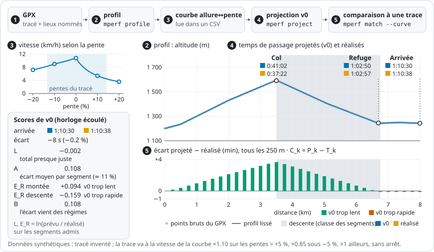

# mountain-performance-analysis

Analyse de données de sport de montagne et modélisation de la performance.

Premier outil : projeter les temps de passage sur un tracé GPX à partir de la
courbe allure↔pente de l'athlète, et valider ces projections contre des
performances réelles. Aujourd'hui, `mperf` construit le profil d'un GPX, y projette
des temps de passage avec une courbe lue dans un fichier, apparie une trace
réalisée à un tracé pour en calculer les scores, et enregistre le backtest de v0 et
de quatre autres modèles sur les performances réelles de l'athlète. En Python, pour
un usage personnel d'abord ; le dépôt ne contient aucune donnée personnelle.

Une seconde piste partage le dépôt et sa méthode : l'analyse des données
d'entraînement, de récupération et de sommeil de l'athlète, des tableaux de bord
jusqu'à l'apprentissage automatique (jalons `AN`, [`docs/analyse/`](docs/analyse/)).
Elle ingère déjà les activités et les données journalières (sommeil, HRV, FC de
repos, Body Battery, indicateurs de Garmin) des exports Garmin (`mperf ingest`), tire
des activités les tables des activités et des montées (`mperf tables`) et la figure
descriptive de sa première question, la vitesse ascensionnelle à terrain comparable
(`mperf q1`).



*La chaîne de bout en bout, produite par le code de `main` (`just figure`), sur des données entièrement synthétiques. Un tracé inventé est rééchantillonné et lissé (profil) ; le moteur v0 y projette les temps de passage à partir d'une courbe allure↔pente synthétique, à effort constant, sans effet de régime ni fatigue. Une trace réalisée inventée — 10 % plus rapide que la courbe en montée, 15 % plus lente en descente, sans arrêt — est appariée au tracé. À l'arrivée, le temps total est presque juste ; pourtant le réalisé avait plusieurs minutes d'avance au col : les erreurs se compensent. Les métriques du backtest ([`0010`](docs/decisions/0010-protocole-de-backtest.md), D7.2) les font apparaître : l'écart moyen par segment `A` est grand alors que l'écart global `L` est presque nul, et il vient entièrement de la différence entre régimes (`B`, `E_R`). C'est le protocole de mesure qui voit ces erreurs, pas le modèle. Les nombres illustrent la mesure, pas une performance du modèle.*

## Pourquoi

Les règles classiques sont les mêmes pour tous les coureurs : Naismith, par
exemple, compte 5 km/h plus 1 h par 600 m de D+. Ici, la vitesse vient d'une
courbe vitesse = f(pente) propre à l'athlète, appliquée pas à pas le long du tracé.

- **Livré (moteur v0)** : `v = vitesse(pente) × effort`, avec un effort constant et
  sans dégradation : ni fatigue, ni altitude, ni chaleur. La courbe est lue dans
  un fichier, que `just curve` estime depuis les activités qu'ingère la piste
  analyse (M6b).
- **Prévu (M6a)** : la dégradation au fil de la course, dont la fatigue en
  descente selon la **profondeur** de la descente en cours, pas seulement selon
  l'avancement.

Le backtest compare v0 à quatre autres modèles : v0 + effort recalé, et trois
modèles de référence — vitesse constante, Naismith, Tobler —, chacun calé sur les
entraînements terminés avant l'origine de la performance évaluée, à 00:00 sept jours
avant son jour ([`0010`](docs/decisions/0010-protocole-de-backtest.md), D2.5 et D9).
Un effet n'entrera dans le modèle que s'il fait baisser l'erreur mesurée, ou avec une
justification écrite : la règle d'admission (D10) compare le modèle avec et sans
l'effet, performance par performance, sur une cible déclarée d'avance, et vérifie que
le reste de l'erreur ne se dégrade pas au-delà de tolérances fixées d'avance (les
garde-fous). Son verdict reste exploratoire, jamais une preuve.

## Installation

Prérequis : [`uv`](https://docs.astral.sh/uv/) et `git`. Python 3.12, la version de
la CI, que uv installe au besoin : la suite n'est verte que sous 3.12 (sous 3.13 et
3.14, un test de l'écriture canonique échoue ; ligne « La suite n'est verte que sous
Python 3.12 » de [`BACKLOG.md`](BACKLOG.md)), d'où le `.python-version` du dépôt, que
uv suit en créant le `.venv`, et le `--python 3.12` ci-dessous.

```bash
git clone https://github.com/rdwk2/mountain-performance-analysis.git
cd mountain-performance-analysis
uv tool install rust-just       # la commande `just`
uv sync --locked --python 3.12  # .venv en Python 3.12, dépendances aux versions de uv.lock
just check                      # lint + types + tests : doit être vert
```

Aucune dépendance de calcul : la seule dépendance d'exécution est `tzdata`, sous
Windows. L'ingestion (`mperf ingest`, qui lit les FIT) demande en plus l'extra `ingest`
(fitdecode, [`0011`](docs/decisions/0011-bibliotheques-analyse.md)) :
`uv sync --locked --extra ingest`, ou `just ingest`, qui l'installe de lui-même ; sans
lui, les tests qui lisent des FIT se sautent. L'écriture des tables de `processed/` en
Parquet et la figure de Q1 demandent l'extra `analyse` (pyarrow et plotly,
[`0014`](docs/decisions/0014-montees-et-tables.md),
[`0015`](docs/decisions/0015-figure-de-q1.md)) : `uv sync --locked --extra analyse`,
ou `just process` et `just q1` ; sans lui, les tests qui écrivent du Parquet ou rendent
la figure se sautent.
L'interface demande l'extra `tableau` (Streamlit,
[`0016`](docs/decisions/0016-interface-v0.md)) : `uv sync --locked --extra tableau`, ou
`just ui` ; sans lui, les tests de l'interface se sautent. Le serveur n'écoute que la
machine, sans télémétrie (`.streamlit/config.toml`).
`just check` enchaîne trois recettes :

| Recette | Ce qu'elle lance |
|---|---|
| `just lint` | `ruff check`, puis `ruff format --check` |
| `just types` | `mypy` strict sur `src/`, `tests/` et `scripts/` |
| `just test` | `pytest` |

`just fmt` formate et corrige ; `just dictionary` régénère
[`docs/DICTIONNAIRE_DONNEES.md`](docs/DICTIONNAIRE_DONNEES.md) ; `just figure`
régénère la figure ci-dessus. La CI
([`.github/workflows/ci.yml`](.github/workflows/ci.yml)) lance `just check` sur
une machine vierge, sous Python 3.12, sans extra, puis toute la suite, et les types, avec
tous les extras, à chaque push et à chaque pull request.

`MPA_DATA_DIR`, le dossier des données personnelles hors du dépôt, sert au backtest
enregistré (`just backtest` : manifeste, courbe, registre, rapports), à l'ingestion
(`just ingest` : `raw/garmin/` lu, `interim/activities/` et `interim/days/`
écrits), aux tables (`just process` :
l'ingestion, puis `interim/activities/` et `athlete.toml` lus, `processed/` écrit), à la figure
de Q1 (`just q1` : `processed/` lu, `resultats/Q1/` écrit), à la courbe personnelle
(`just curve` : `interim/activities/` lu, `reference/` écrit) et à l'interface
(`just ui` : `routes/`, `sorties/` et `reference/` lus ; `routes/` et `sorties/` écrits
par l'ajout d'un fichier) ; les autres commandes ne le lisent pas, les tests non plus
([`tests/conftest.py`](tests/conftest.py) le pose sur un dossier temporaire neuf
pour chaque test). Pour le renseigner, copier [`.env.example`](.env.example) en
`.env` ; `just` charge `.env` s'il existe. Sous Windows, écrire le chemin avec des
barres obliques.

## Utilisation : `mperf`

Huit sous-commandes, installées par `uv sync` ; `ingest`, `tables` et `q1` demandent en
plus leur extra (`ingest`, `analyse`). Les exemples ci-dessous ont été exécutés depuis la
racine du dépôt, sur des fixtures synthétiques commitées
([`tests/fixtures/`](tests/fixtures/README.md)) ; celui du backtest, sur le monde
synthétique que les tests écrivent dans un dossier temporaire.

### `mperf profile` — le profil d'un GPX

Lit un GPX, le rééchantillonne sur une grille à pas fixe, lisse l'altitude et
résout les lieux nommés (`<wpt>`) le long du tracé.

```bash
uv run mperf profile tests/fixtures/mini_11.gpx
```

```text
fichier      mini_11.gpx   sha256 7fdb9d12…
lecture      11 points, 0 écartés (doublons), 1 tronçon
grille       1 000 m, 21 points, pas 50 m
lissage      150 m demandé → 150 m effectif (3 points)
dénivelé     D+ 44 m / D− 44 m        (brut : D+ 50 m / D− 50 m)
points       2 résolus sur 2, 0 <wpt> sans nom ignoré(s)
```

| Option | Rôle | Défaut |
|---|---|---|
| `--step-m F` | pas de la grille (m) | 50 |
| `--smoothing-m F` | fenêtre de lissage de l'altitude (m) ; 0 = aucun lissage | 150 |
| `--max-offset-m F` | écart maximal d'un lieu au tracé pour retenir un passage (m) | 150 |
| `--min-separation-m F` | séparation minimale des passages (m) ; 0 = aucune contrainte | 500 |
| `--csv` | la grille sur stdout : `distance_m,elevation_m,grade` | — |

Les défauts du pas et du lissage sont provisoires : leur validation sur des
fichiers réels est différée.

### `mperf project` — les temps de passage

Projette des temps de passage sur un GPX, avec le moteur v0
([`0009`](docs/decisions/0009-moteur-projection-v0.md)).

```bash
uv run mperf project tests/fixtures/mini_11.gpx --curve tests/fixtures/courbe_synthetique.csv
```

```text
fichier      mini_11.gpx   sha256 7fdb9d12…
courbe       courbe_synthetique.csv   sha256 6767dd38…
             3 activités, 2026-01-01 → 2026-01-31
grille       1 000 m, 21 points, pas 50 m
lissage      150 m demandé → 150 m effectif (3 points)
support      9 tranches lues, 5 retenues (>= 10 min), plage −20 % … +20 %
             pentes rencontrées : −10 % … +10 %
             hors support : 0 % de la distance, 0 % du temps
effort       1.00
durée        0:08:30   (D+ 44 m / D− 44 m)
passages     4   (2 lieux résolus, départ et arrivée synthétisés)
      0 m   Départ                 0:00:00
      0 m   Départ                 0:00:00
    500 m   Col                    0:05:14
  1 000 m   Arrivée                0:08:30
```

Le départ et l'arrivée sont toujours synthétisés, même quand le GPX porte déjà un
lieu à ces abscisses : d'où deux lignes « Départ » à 0 m, le départ synthétisé
puis le lieu nommé de `mini_11.gpx` (docstring de `project` dans
[`model/engine.py`](src/mountain_perf/model/engine.py), test
`test_start_and_finish_are_synthesised_even_over_a_named_place` de
[`tests/test_model_engine.py`](tests/test_model_engine.py)).

| Option | Rôle | Défaut |
|---|---|---|
| `--curve fichier.csv` | courbe allure↔pente, **obligatoire**, avec son compagnon `<nom>.meta.json` à côté | — |
| `--effort F` | facteur multiplicatif sur la vitesse ; 1 = la référence des activités qui ont construit la courbe | 1.0 |
| `--min-support-min F` | données minimales par tranche de pente pour la retenir (min) ; 0 = aucun filtre | 10 |
| `--step-m`, `--smoothing-m`, `--max-offset-m`, `--min-separation-m` | comme pour `profile` | |
| `--csv` | le tableau des passages sur stdout, durées en secondes | — |

Colonnes du CSV : `name`, `distance_m`, `elevation_m`, `arrival_s`,
`departure_s`, `moving_time_s`, puis `segment_duration_s`, `segment_distance_m`,
`segment_ascent_m`, `segment_descent_m`, qui décrivent le tronçon **qui précède**
le passage (vides sur la première ligne).

### `mperf match` — une trace réalisée face à un tracé

L'outil d'appariement du backtest, selon le protocole
[`0010`](docs/decisions/0010-protocole-de-backtest.md) : apparie une trace
réalisée (GPX horodaté) à un tracé de référence. Le rapport donne les points de
score (sections 1 à 4), puis les segments, la couverture, le préfixe comparable,
les horloges et les épisodes d'arrêt (5 à 9), puis les passages nommés (10).

```bash
uv run mperf match tests/fixtures/appariement_reference.gpx tests/fixtures/appariement_trace_x01.gpx
```

```text
référence    appariement_reference.gpx   sha256 48132bc6…
             L 530 m, D+/km 0 m/km
trace        appariement_trace_x01.gpx
             33 enregistrements, 0 instant dupliqué écarté, écoulé 0:05:20, 1 bloc, 0 trou
départ       ancré — b_0 25.00 m, durée avant départ 0:00:00
arrivée      ancré — instant 0:05:20, b_K 505.00 m, L − b_K 25.00 m
points       Δ 250 m, ε 30 m, r_c 15 m — 4 points
             trouvé 2, ancré 2, ambigu 0, absent 0, hors ε 0, tangente indéfinie 0
             ambigus : aucun
segments     3 admis sur 3
             borne non observée 0 (0.00 m), trou 0 (0.00 m)
             rapport de longueur 0 (0.00 m), écart intérieur 0 (0.00 m)
             ancrage exclu 50.00 m
couverture   90.57 % — montée non évalué, plat 90.57 %, descente non évalué
             écoulé admis 0:05:20
             temps exclus : trou 0:00:00, rapport de longueur 0:00:00, écart intérieur 0:00:00
             durées inconnues : 0 segment
préfixe      3 segments, b_m 505.00 m, t*_m 0:05:20, dernier passage aucun
horloges     M / S / U de la trace, puis du support admis
             θ1  trace 0:04:20 / 0:00:00 / 0:01:00   admis 0:04:20 / 0:00:00 / 0:01:00
             θ2  trace 0:04:20 / 0:00:00 / 0:01:00   admis 0:04:20 / 0:00:00 / 0:01:00
             θ3  trace 0:04:20 / 0:00:00 / 0:01:00   admis 0:04:20 / 0:00:00 / 0:01:00
             θ4  trace 0:04:20 / 0:00:00 / 0:01:00   admis 0:04:20 / 0:00:00 / 0:01:00
             θ5  trace 0:04:20 / 0:00:00 / 0:01:00   admis 0:04:20 / 0:00:00 / 0:01:00
             θ_bas θ1, θ_haut θ1, I_sens,A [0:04:20 ; 0:05:20]
épisodes     sous θ_c : 0 épisode, 0:00:00
passages     0 occurrence — trouvé 0, ancré 0, ambigu 0, absent 0, hors ε 0, tangente indéfinie 0, hors préfixe 0 ; comparables 0
             épisodes θ_c : attribués 0, sans candidate 0, non attribués 0
```

Avec `--curve`, le rapport ajoute les scores de v0 brut (sections 11 à 13) : les
scénarios usage et contrôle, les métriques sous chaque horloge du rapport, les
écarts `C_k` aux points et la cible d'usage `K`. Pour rejouer l'exemple complet :

```bash
uv run mperf match tests/fixtures/appariement_reference.gpx tests/fixtures/appariement_trace_x01.gpx --curve tests/fixtures/courbe_synthetique.csv
```

Extrait : les dix lignes qui suivent les sections 1 à 10 ci-dessus (section 11,
puis début de la section 12).

```text
v0 brut      courbe courbe_synthetique.csv   sha256 6767dd38…
             effort 1.00, moteur projection-v0 ; horloges du rapport : écoulé, M θ1, (M+U) θ1
usage        appariement_reference.gpx ; 3 segments admis : montée 0, plat 3, descente 0, mixte 0
             enveloppe       support [−0.693147 ; −0.485508], min |L| 0.485508
                             montée non évalué
                             plat [−0.693147 ; −0.485508], min |L| 0.485508
                             descente non évalué
                             mixte non évalué
                             écoulé              M θ1                (M+U) θ1
             L               −0.693147           −0.485508           −0.693147
```

| Option | Rôle | Défaut |
|---|---|---|
| `--delta-m F` | Δ, pas de la grille de score (m) | 250 |
| `--eps-m F` | ε, tolérance latérale et d'ancrage (m) | 30 |
| `--curve courbe.csv` | courbe allure↔pente : ajoute les scores de v0 brut | — |
| `--no-reference` | sortie sans référence : la référence doit être la trace elle-même (`0010` D3) | — |

Le rayon de regroupement `r_c` n'a pas d'option : il reste à son défaut, 15 m.

### `just backtest` — le backtest enregistré des cinq modèles

`just backtest <courbe.csv>` lance `mperf backtest` sur le manifeste
`MPA_DATA_DIR/reference/manifeste.json` et la courbe nommée, du même dossier
([`0010`](docs/decisions/0010-protocole-de-backtest.md), D9, D14 et D15) : sorties
retenues, domaine et performances ; appariement et scores de chaque sortie sous cinq
modèles — v0 brut, v0 + effort recalé, vitesse constante, Naismith et Tobler, les quatre
derniers calés sur les entraînements terminés avant l'origine de chaque performance ;
référence de répétabilité (D8) de chaque parcours du jeu de répétabilité ; au rapport
complet seulement, le diagnostic de longue course (D12) de chaque sortie scorée et, pour une
sortie à référence, ses fourchettes (D11), que le registre garde aussi. Une sortie
peut être déclarée au manifeste dans un jeu (répétabilité, développement ou
confirmation, D2.3) ; les agrégats se publient jeu par jeu, et une performance sans
jeu n'entre dans aucun. L'exécution est enregistrée dans
`MPA_DATA_DIR/registre/` (une DÉCLARATION avant le calcul, dont l'empreinte s'affiche
aussitôt, puis un RÉSULTAT ou un ÉCHEC) ; le rapport complet est écrit dans
`MPA_DATA_DIR/rapports/backtest-<n° du RÉSULTAT>.txt`, jamais réécrit. La synthèse
s'affiche avec le sceau du registre, l'empreinte de sa dernière ligne : l'entrée du
[`JOURNAL`](docs/JOURNAL.md) d'une exécution réelle recopie ce sceau et, au plus, les
agrégats par jeu, jamais la synthèse par sortie, qui date et nomme les sorties (règle 1
de [`CLAUDE.md`](CLAUDE.md)). Le code exécuté doit être celui d'un clone git, installé
par `uv sync` : la commande refuse un clone dont un fichier suivi est modifié, et
enregistre le commit du code exécuté. Le manifeste décrit chaque sortie (`0010` D2.6 ;
lecture : [`backtest/manifest.py`](src/mountain_perf/backtest/manifest.py)) ; exemples
synthétiques : [`tests/fixtures/manifeste/`](tests/fixtures/manifeste/README.md), et le
monde de [`tests/fixtures/backtest_world.py`](tests/fixtures/backtest_world.py),
exécutable de bout en bout.

```bash
just backtest courbe.csv
```

Extrait de la synthèse, sur le monde synthétique des tests
(`tests/fixtures/backtest_world.py`) : le calage de chaque performance (effort de v0,
facteur de chaque baseline), puis, jeu par jeu, les agrégats d'usage sous l'écoulé des
cinq modèles, à poids égal par performance, et `|L|` sur les performances où les cinq
ont une valeur. Aucun entraînement n'est terminé avant l'origine des cinq premières
performances, sept jours avant chacune : leur `C_j` est vide, et les modèles calés n'y
ont pas de valeur (« non calé », « — (0) »).

```text
calage       0010 D9.2 sur C_j (entraînements terminés avant o_j) ; écoulé, usage (contrôle sans référence) ; e : effort de v0, a : facteur
             jour        C_j  C_j^eff  v0 + effort recalé  vitesse constante   Naismith            Tobler
             2026-06-03  0    0        non calé            non calé            non calé            non calé
             2026-06-04  0    0        non calé            non calé            non calé            non calé
             2026-06-06  0    0        non calé            non calé            non calé            non calé
             2026-06-08  0    0        non calé            non calé            non calé            non calé
             2026-06-10  0    0        non calé            non calé            non calé            non calé
             2026-06-12  2    2        e 1.032806          a 0.529643          a 0.517033          a 0.578027 (jour multi-sorties, a-2026-06-12)
             2026-06-14  3    3        e 0.994408          a 0.557052          a 0.540004          a 0.599883
             2026-06-15  3    3        e 1.005992          a 0.546608          a 0.532632          a 0.593522 (contrôle)
             2026-06-16  4    —        non scorée
             2026-06-20  6    —        non scorée
             2026-06-25  8    6        e 1.022058          a 0.540342          a 0.521925          a 0.586222
             2026-06-27  8    6        e 1.022058          a 0.540342          a 0.521925          a 0.586222
agrégats     usage, écoulé ; moyenne à poids égal par performance (effectif) ; |L| commun : performances où les cinq modèles ont une valeur ; détail et motifs : rapport complet
             répétabilité    v0 brut             v0 + effort recalé  vitesse constante   Naismith            Tobler
             L               +0.025018 (5)       — (0)               — (0)               — (0)               — (0)
             |L|             0.057571 (5)        — (0)               — (0)               — (0)               — (0)
             max |C_k|       132.4 (5)           — (0)               — (0)               — (0)               — (0)
             q_usage         0.059984 (4)        — (0)               — (0)               — (0)               — (0)
             |L| commun      — (0)               — (0)               — (0)               — (0)               — (0)
             développement   v0 brut             v0 + effort recalé  vitesse constante   Naismith            Tobler
             L               +0.132283 (1)       +0.137890 (1)       +0.112756 (1)       +0.126724 (1)       +0.139436 (1)
             |L|             0.132283 (1)        0.137890 (1)        0.112756 (1)        0.126724 (1)        0.139436 (1)
             max |C_k|       301.6 (1)           315.2 (1)           292.2 (1)           287.7 (1)           319.0 (1)
             q_usage         0.136219 (1)        0.141843 (1)        0.120012 (1)        0.144985 (1)        0.121469 (1)
             |L| commun      0.132283 (1)        0.137890 (1)        0.112756 (1)        0.126724 (1)        0.139436 (1)
             confirmation    v0 brut             v0 + effort recalé  vitesse constante   Naismith            Tobler
             L               +0.085392 (2)       +0.063574 (2)       +0.073070 (2)       +0.062541 (2)       +0.067179 (2)
             |L|             0.085392 (2)        0.063574 (2)        0.073070 (2)        0.062541 (2)        0.067179 (2)
             max |C_k|       177.4 (2)           132.8 (2)           225.2 (2)           192.1 (2)           151.0 (2)
             q_usage         0.088736 (2)        0.067154 (2)        0.091030 (2)        0.073195 (2)        0.066100 (2)
             |L| commun      0.085392 (2)        0.063574 (2)        0.073070 (2)        0.062541 (2)        0.067179 (2)
```

Avec `--sensitivity`, la commande enchaîne, après le rapport de l'exécution centrale, la
sensibilité de [`0010`](docs/decisions/0010-protocole-de-backtest.md), D13 : la même
déclaration rejouée sous dix-neuf configurations — les neuf paires (Δ, ε) sous l'écoulé,
et la paire centrale (250 m, 30 m) sous les dix horloges de mouvement —, chacune comparée
au comparateur (250 m, 30 m, écoulé) sur trois axes : la disponibilité de chaque valeur,
son support effectif, sa valeur. Neuf appariements au lieu d'un : elle dure plusieurs
fois l'exécution centrale. Elle s'enregistre en une DÉCLARATION de sensibilité, qui
nomme la déclaration centrale qu'elle qualifie, puis un RÉSULTAT ou un ÉCHEC, et ne
compte pas comme un essai de plus (D14). Le rapport
`MPA_DATA_DIR/rapports/sensibilite-<n° du RÉSULTAT>.txt` donne, par configuration, les
agrégats d'usage sous son horloge, les trois axes par modèle, `L` de v0 brut performance
par performance, les fourchettes de sa paire sous l'écoulé et la dérive de v0 brut. La
sensibilité est rapportée, jamais utilisée pour choisir. Extrait de sa synthèse sur le
monde synthétique : pour v0 brut, les valeurs comparées, perdues, gagnées, de support
changé et changées, configuration par configuration.

```bash
just backtest courbe.csv --sensitivity
```

```text
             v0 brut                             valeurs comparées   perdues             gagnées             support changé      valeur changée
              1  Δ 100 m, ε 15 m, écoulé         72                  0                   0                   64                  59
              2  Δ 100 m, ε 30 m, écoulé         72                  0                   0                   64                  59
              3  Δ 100 m, ε 45 m, écoulé         72                  0                   0                   64                  59
              4  Δ 250 m, ε 15 m, écoulé         72                  0                   0                   0                   0
              5* Δ 250 m, ε 30 m, écoulé         72                  0                   0                   0                   0
              6  Δ 250 m, ε 45 m, écoulé         72                  0                   0                   0                   0
              7  Δ 500 m, ε 15 m, écoulé         72                  0                   0                   64                  47
              8  Δ 500 m, ε 30 m, écoulé         72                  0                   0                   64                  47
              9  Δ 500 m, ε 45 m, écoulé         72                  0                   0                   64                  47
             10  Δ 250 m, ε 30 m, M θ1           72                  30                  0                   35                  35
             11  Δ 250 m, ε 30 m, M θ2           72                  30                  0                   35                  35
             12  Δ 250 m, ε 30 m, M θ3           72                  30                  0                   35                  35
             13  Δ 250 m, ε 30 m, M θ4           72                  30                  0                   35                  35
             14  Δ 250 m, ε 30 m, M θ5           72                  30                  0                   35                  35
             15  Δ 250 m, ε 30 m, (M+U) θ1       72                  0                   0                   0                   5
             16  Δ 250 m, ε 30 m, (M+U) θ2       72                  0                   0                   0                   5
             17  Δ 250 m, ε 30 m, (M+U) θ3       72                  0                   0                   0                   5
             18  Δ 250 m, ε 30 m, (M+U) θ4       72                  0                   0                   0                   5
             19  Δ 250 m, ε 30 m, (M+U) θ5       72                  0                   0                   0                   5
             * comparateur
```

| Option de `mperf backtest` | Rôle | Défaut |
|---|---|---|
| `--curve courbe.csv` | courbe allure↔pente, **obligatoire** : une entrée déclarée de l'exécution | — |
| `--descent-threshold F` | seuil des descentes roulantes et raides (diagnostic de `0010` D6), dans [0.60 ; 1] | 0.80 |
| `--sensitivity` | puis la sensibilité de `0010` D13, enregistrée, et son rapport `sensibilite-<n>.txt` | absente |

### `just ingest` — l'ingestion des exports Garmin

`just ingest` lance `mperf ingest` avec l'extra `ingest` : il lit les exports Garmin
rangés sous `MPA_DATA_DIR/raw/garmin/` et écrit `MPA_DATA_DIR/interim/activities/`
([`0013`](docs/decisions/0013-ingestion-et-interim.md)) et
`MPA_DATA_DIR/interim/days/` ([`0018`](docs/decisions/0018-donnees-journalieres.md)).
Chaque export a son
dossier, `raw/garmin/<export>/` (lettres et chiffres ASCII, `_`, `.` et `-`, sauf
`activities` et `acquisition.json`, réservés : dans `raw/garmin/`, ils désignent un
export laissé à plat ; le nom ne sert qu'au rapport), qui comprend :

- `acquisition.json`, l'instant où l'export a été obtenu, écrit à la main
  (`{"retrieved_at": "<instant ISO 8601 avec fuseau>"}`) ;
- `activities/activities.json`, l'index des activités ;
- `activity_fit/<identifiant>.zip`, une archive par activité, qui contient son FIT ;
- `<famille>/<AAAA-MM-JJ>.json`, un fichier par jour pour chacune des onze familles
  journalières (`sleep`, `hrv`, `resting_hr`, `heart_rate`, `body_battery`, `stress`,
  `respiration`, `spo2`, `daily_summary`, `training_readiness`, `training_status`) ;
  une famille peut manquer, et un export sans aucune est admis.

Les autres dossiers de `raw/` sont laissés aux autres sources. Aucun export ne se
retire : Garmin efface avec le temps le détail des jours, et un export ancien en reste
la seule source. Pour chaque activité, l'export qui fait foi est le plus récent dont
la période (du premier départ de ses entrées gardées à son instant d'acquisition)
couvre son départ : une activité qu'il ne porte pas n'est pas ingérée, elle est
« retirée de la source ». Pour chaque jour, l'export de référence est le plus récent
où le jour est complet et a encore son détail, sinon le plus récent où il est
complet, puis tronqué, puis sans mesure, puis le plus récent qui le porte ; une
famille ou une série qu'il n'a pas, ou les segments de la nuit, peuvent venir du plus
récent des autres exports qui les porte, si leurs fenêtres s'accordent (même début de la
fenêtre du jour, même nuit à la seconde ; pour les segments, leurs durées aussi).

Dans `interim/activities/`, l'ingestion écrit trois choses :

- l'index des activités, avec la provenance de chaque export ;
- un enregistrement par activité dont un FIT se lit : un canal par grandeur, chacun
  avec ses instants, sans interpolation ;
- le rapport de l'ingestion : par export, sa période et ses entrées ; les fichiers lus
  et refusés, les entrées de l'index refusées, les activités retirées de la source,
  les activités sans vue `Activity`, les désaccords entre un FIT et son entrée, et ce
  qui diffère d'un export à l'autre (champs de l'index, FIT).

Dans `interim/days/`, trois choses aussi :

- un document par jour : sa fenêtre et son état (complet, tronqué, sans mesure,
  vide), sa nuit principale (rattachée au jour du réveil) et ses siestes, une valeur
  par grandeur, les séries de la journée et de la nuit, sans interpolation, les
  entrées de Training Readiness, et la provenance de chaque nuit, sieste, résumé,
  série et entrée ;
- Training Status, chaque bloc à sa date propre ;
- le rapport des jours : par export, ses jours et ses familles ; les fichiers lus et
  refusés, les jours par export de référence, les emprunts et leurs refus, les écarts
  entre exports (emprunts, dégradations, révisions, à part) ; les points écartés et les
  codes inconnus, avec leur motif : ceux de la lecture sur les seules lectures retenues
  (la référence et les familles empruntées entières, pas le prêteur d'une série ou de
  segments seuls), et les points que l'assemblage jette (nuit absente, jour sans
  fenêtre).

Rien n'est corrigé : une valeur écartée est comptée, avec son motif. `raw/` n'est jamais
écrit. Une ingestion qui s'arrête sur une erreur avant d'écrire laisse en place les
`interim/activities/` et `interim/days/` précédents ; si les jours ne prennent pas leur
place après les activités, le message le dit, et relancer `just ingest` remet tout en
ordre. Deux ingestions des mêmes fichiers écrivent les mêmes octets. Le moteur lit
`interim/` par ses vues : la trace d'un enregistrement (`trace_view`) pour
`just curve` (M6b) ; il lira les jours par les vues de `ingest/day_views.py` (M7) :
une vue prise à un instant ne rend que ce dont l'instant propre (la fin d'une nuit,
l'instant d'un point) est au plus tard cet instant, ou strictement avant, et ses
seuils sont des arguments.

```bash
just ingest
```

La sortie donne d'abord le nombre d'exports, puis une ligne par export (son instant
d'acquisition, ses entrées gardées et refusées, ses archives). Elle compte ensuite les
activités de l'index, les enregistrements, les fichiers refusés, les entrées refusées,
les entrées sans archive, les désaccords et les activités sans vue `Activity`, avec une
ligne par couple (motif, type de la source) de ces dernières ; enfin les activités
retirées de la source, les champs de l'index qui diffèrent d'un export à l'autre (une
ligne par champ), les activités aux FIT différents et les enregistrements tirés d'un
autre export que leur entrée. Viennent ensuite les jours : leur nombre, une ligne par
export de référence et une par état du jour, puis les morceaux empruntés, les emprunts
refusés, les révisions, les dégradations et les écarts à part entre exports (en champs
× jours), les fichiers journaliers refusés, les points écartés, les codes inconnus, les
blocs de Training Status et ceux sans instant propre. Pas d'exemple ici : sur les
exports réels, ces nombres
restent hors du dépôt ([`docs/analyse/CHARTE.md`](docs/analyse/CHARTE.md), § 10).

### `just process` — les tables des activités, des montées et des variantes

`just process` régénère tout depuis `raw/` : l'ingestion (`mperf ingest`, extra
`ingest`), puis `mperf tables` (extra `analyse`), qui lit
`MPA_DATA_DIR/interim/activities/` et écrit trois tables Parquet dans
`MPA_DATA_DIR/processed/` ([`0014`](docs/decisions/0014-montees-et-tables.md)) :

- `activites.parquet`, une ligne par activité de l'index : les valeurs de l'index (hors
  de la charge selon Garmin, qui reste dans `interim/`), le temps de mouvement du moteur
  sous ses cinq conventions, le pas, les trous et les pauses, l'appareil, et les montées
  comptées par régime ;
- `montees.parquet`, une ligne par montée : ses bornes en temps, son gain, sa vitesse
  ascensionnelle (le gain pris en mouvement divisé par le temps en mouvement, avec sa
  variante et son enveloppe), sa pente, son régime (côte, intermédiaire, montée longue,
  ski de randonnée, ski de randonnée court, autre sport), ses strates de pente et
  d'altitude, ses drapeaux et sa stabilité ;
- `variantes.parquet`, une ligne par montée de chaque variante déclarée de la
  définition (celles que la stabilité recalcule) : ses bornes, son gain, son gain pris
  en mouvement et son temps en mouvement, son régime, ses strates et ses drapeaux sous
  les paramètres de la variante ; la stabilité des points de la figure de Q1 la lit
  ([`0015`](docs/decisions/0015-figure-de-q1.md)).

Les montées se détectent sur le profil du moteur ; leurs bornes et leur gain se lisent
en temps, sur l'altitude lissée du moteur, et un replat qui monte doucement reste hors
de la montée, à un pas de grille près (un bout plus court qu'un pas peut y rester et
diluer la VAM d'une côte courte) ; près de la pente d'un replat, le bruit de l'altitude
peut y laisser bien plus (`docs/decisions/0014`). Un drapeau marque une montée sans la
retirer. Les trois fichiers portent la même provenance : l'empreinte d'`interim/activities/`, le
commit et la version du paquet, et tous les paramètres de la définition ; régénérés
depuis le même `interim/activities/` par le même code, avec le même `athlete.toml` et la même
version de pyarrow (celle de `uv.lock`), ils sont identiques à l'octet sur la même
plateforme (d'un système à l'autre, les derniers chiffres d'un nombre peuvent
différer). Comme pour `just backtest`, le code exécuté doit être celui d'un clone git,
installé par `uv sync`, et `mperf tables` refuse un clone dont un fichier suivi est
modifié : le commit doit dire le code qui a écrit les tables. Les trois fichiers
s'écrivent dans un dossier à part, puis prennent ensemble la place de `processed/` :
une écriture qui échoue laisse les tables d'avant.

`MPA_DATA_DIR/athlete.toml` peut déclarer, dans sa table `[analyse]`, la vitesse
ascensionnelle de référence qui fixe la frontière des régimes, et les produits de
montre qui portent un baromètre :

```toml
[analyse]
reference_vertical_speed_m_per_h = 900
barometer_products = [{ manufacturer = "garmin", product = 1 }]
```

Absente, la vitesse prend le défaut du projet (900 m/h) ; elle ne se calcule pas sur
les données, pour que les régimes ne dépendent pas de la mesure.

```bash
just process
```

Après l'ingestion, `mperf tables` dit le nombre d'activités et de montées, les
montées par régime, les montées marquées et instables, les montées des variantes,
l'empreinte d'`interim/activities/`, le commit et les fichiers écrits. Pas d'exemple ici, pour la
même raison.

### `just q1` — la figure de Q1

`just q1` (`mperf q1`, extra `analyse`) lit les tables de `MPA_DATA_DIR/processed/` et
écrit la figure de Q1, « la VAM progresse-t-elle, à pente, gain et altitude
comparables ? » ([`docs/analyse/QUESTIONS.md`](docs/analyse/QUESTIONS.md),
[`0015`](docs/decisions/0015-figure-de-q1.md)), dans un dossier neuf de
`MPA_DATA_DIR/resultats/Q1/`, nommé par la date du jour et une empreinte de ses entrées,
jamais réécrit :

- `figure.html`, une page autonome (plotly.js inclus) : une rangée par régime (montées
  longues, côtes, ski de randonnée), une colonne par strate de pente ; un point par
  activité et par strate d'altitude (la couleur), placé à sa date ; en ordonnée, sa
  vitesse ascensionnelle en m/h, échelle logarithmique : le gain pris en mouvement
  divisé par le temps en mouvement, sommés sur ses montées gardées (non marquées,
  d'une activité à une seule session, avec leurs strates). Un point creux
  est instable sous les variantes de la définition ; un trait pointillé marque chaque
  changement de montre ; une facette de moins de cinq activités reste vide. Une seconde
  vue ne garde que les montées stables. Figure descriptive : ni courbe ajustée, ni
  lissage, ni intervalle ;
- `points.csv`, les points des deux vues ; `flux.csv`, mois par mois et par régime, ce
  que la figure montre et ce qu'elle écarte, par motif ;
- `provenance.json` : le commit et la version du paquet, la période, la provenance des
  tables lues, les paramètres de la figure, l'empreinte de chaque fichier.

```bash
just q1
```

`mperf q1` demande, comme `mperf tables`, un clone git dont aucun fichier suivi n'est
modifié. Il refuse des tables d'avant cette figure (sans `variantes.parquet`), une table
qui manque ou qui ne se relit pas : relancer `just process`. Il
dit, par vue et par régime, les points montrés, cachés et instables, les changements de
montre, et le dossier écrit ; si les tables viennent d'un autre commit que le code, une
ligne le dit. Pas d'exemple ici : la figure et ses comptes restent hors du dépôt
([`docs/analyse/CHARTE.md`](docs/analyse/CHARTE.md), § 10).

### `just curve` — la courbe personnelle

`just curve` (`mperf curve`) estime une courbe allure ↔ pente depuis les activités de
`MPA_DATA_DIR/interim/` — l'`interim/` régénéré par `just ingest`, lu par les vues du
moteur, jamais `processed/` — et l'écrit dans `MPA_DATA_DIR/reference/<nom>.csv`, avec
son compagnon `<nom>.meta.json` ; ni l'un ni l'autre n'est jamais réécrit
([`0017`](docs/decisions/0017-estimation-de-la-courbe.md)).

La courbe se mesure comme le moteur l'applique : sur les intervalles de la grille du
profil du moteur, chacun avec la pente de l'altitude lissée du profil, sa longueur
entière (la distance des positions brutes, trous compris) et son temps en mouvement
sous la convention centrale θc (`0010` D5) ; une vitesse écoulée s'y ajoute, par tranche.
Les tranches sont variables (2,5 % de −15 à +35 %, 5 % ailleurs jusqu'à ±40 %, 10 %
au-delà), à centres nominaux ; la valeur d'une tranche est (a), la somme des longueurs
sur la somme des temps en mouvement, ou, en option, (b), la médiane des vitesses des
activités. Le compagnon dit les quantiles p10, p50 et p90 du niveau des activités (le
niveau d'une activité : son temps en mouvement contre le temps que le moteur prévoit sur
la courbe, un diagnostic d'ajustement, en échantillon ; les niveaux par activité ne sont
pas gardés) et, par tranche, la forme de la courbe (l'écart interquartile, le niveau
retiré). Avec `--hr-center`, un filtre de FC ne garde que les intervalles dont la FC,
décalée de 60 s, est dans une bande de 10 bpm, aux pentes de −5 % ou plus seulement.

| Option | Défaut | Rôle |
|---|---|---|
| `--from`, `--to` | — (obligatoires) | Premier et dernier jour de la fenêtre, compris (`AAAA-MM-JJ`) |
| `--athlete` | — (obligatoire) | Pseudonyme de l'athlète (celui du manifeste) |
| `--types` | `trail_running` | Types de la source retenus, séparés par des virgules, sans espace |
| `--min-duration-min` | — | Durée minimale d'une sortie, en minutes |
| `--max-duration-min` | — | Durée maximale (exclue) d'une sortie, en minutes |
| `--max-elapsed-min` | — | Plafond depuis le départ, en minutes |
| `--hr-center` | — | Centre de la bande de FC (bpm) |
| `--hr-width` | 10 | Largeur de la bande (bpm) |
| `--hr-lag` | 60 | Décalage de la FC (s) |
| `--value` | `a` | Valeur d'une tranche : (a) somme / somme, (b) médiane des activités |

```bash
just curve <nom> --from AAAA-MM-JJ --to AAAA-MM-JJ --athlete <pseudonyme>
```

Comme `just backtest`, la commande refuse un clone dont un fichier suivi est modifié :
la courbe dit le commit qui l'a estimée. Une courbe dont le support ne se lit pas
(`0009` D2) s'écrit quand même, sans niveau ni forme, et la commande le dit. Elle donne
les activités retenues et les tranches, les écarts par motif, les intervalles coupés au
plafond, le nombre d'activités avec un niveau et le rapport écoulé / temps en mouvement.
Pas d'exemple ici : sur les données réelles, ces nombres restent hors du dépôt. Le
détail est dans [`0017`](docs/decisions/0017-estimation-de-la-courbe.md).

## Interface : `just ui`

L'interface ([`0016`](docs/decisions/0016-interface-v0.md)) est une appli Streamlit
locale, sur `MPA_DATA_DIR`, avec l'extra `tableau`. Elle ne calcule rien (règle 7 de
[`CLAUDE.md`](CLAUDE.md)) : ce qu'elle montre vient des fonctions mêmes de `mperf` et de
la bibliothèque. Deux pages : « projection » et « sortie ».

```bash
just ui
```

puis `http://localhost:8501` dans le navigateur.

- **L'ajout d'un fichier** (barre latérale, sur les deux pages) : un GPX téléversé va,
  au choix, dans les préparés (`routes/`) ou dans les sorties (`sorties/`, une trace
  horodatée). Il est lu d'abord, comme la page le lira, puis écrit sous son nom, au clic
  seulement ; un fichier de même nom n'est jamais écrasé, et rien n'est supprimé.
- **La page « projection »** : un préparé (un GPX de `MPA_DATA_DIR/routes/`) et une
  courbe (un CSV de `MPA_DATA_DIR/reference/` et son compagnon `.meta.json`), choisis
  dans la barre latérale.
  - **Les réglages** sont générés depuis les specs des paramètres du profil et du
    moteur : un curseur par paramètre, sur sa plage d'affichage.
  - **Elle montre** la synthèse de `mperf project` (son texte même), le profil avec les
    passages, la vitesse projetée, et le tableau des passages, avec, pour chaque
    tronçon, l'allure et la montée horaire moyennes ; une heure de départ facultative, à
    l'heure de Paris, donne l'heure de chaque passage.
  - **L'export CSV** des passages a le texte de `mperf project --csv` lancée avec les
    seules options qui s'écartent d'un défaut (aux fins de ligne près : sous Windows, la
    commande écrit des CRLF, la page des LF). C'est un format pour un programme
    (virgules, point décimal, UTF-8 sans marque d'en-tête) : Excel en français ne
    l'ouvre pas tel quel (`BACKLOG.md`).
- **La page « sortie »** : un préparé, la trace d'une sortie faite sur lui (un GPX de
  `MPA_DATA_DIR/sorties/`) et une courbe, puis « Comparer » : rien n'est calculé avant
  le clic. Elle montre le jour de la sortie (le jour à Paris de son premier instant),
  la partie comparée du préparé et le préfixe comparable (`0010` D4.11), prévu contre
  réalisé sous les horloges du rapport, et l'effort effectif `e* = exp(L)` sur ton
  préparé et sur le chemin suivi, avec ses limites : rétrospectif, limité à la partie
  comparée, faussé par les arrêts sous l'écoulé, il mêle l'effort du jour et l'erreur
  du modèle, et, sur le préparé, l'écart entre le préparé et le chemin suivi. Puis
  l'écart cumulé aux points, et le plus grand. Un avertissement en tête quand la sortie
  tombe dans la période d'estimation de la courbe (`0010` D2.2). C'est le contrôle d'une
  sortie par v0 brut, à l'effort 1, sans réglage, et rien n'est écrit : pas une erreur
  du modèle, dont le chiffre qui fait foi reste celui du backtest. Le détail (régimes,
  enveloppes, épisodes) : `mperf match --curve`.

## État et plan

- **Moteur de prédiction** : M0 à M4 livrés ; M5 (interface v0) livré, ses deux pages
  (`just ui`) ; le « Fini quand » de la ROADMAP se constate à l'usage. M6b livré :
  l'estimation de la courbe personnelle (`just curve`), et sa mesure par le backtest
  contre la v0 (`docs/JOURNAL.md`). Livrés en M4 :
  l'appariement d'une trace à un tracé, les métriques d'erreur, la référence de
  répétabilité, le registre des expériences, `just backtest` à cinq modèles, son
  diagnostic de longue course et ses fourchettes (`0010` D12 et D11, au rapport complet ;
  les fourchettes aussi au registre), et l'admission exploratoire d'un effet (`0010` D10,
  hors le figement pour confirmation de D10.7), calculée par la bibliothèque — sa commande
  viendra avec le premier effet, au M6a ; enfin la sensibilité (`0010` D13,
  `just backtest courbe.csv --sensitivity`).
- **Piste analyse** : cadrage livré (AN0 : charte, questions, décisions 0011 à 0013) ;
  AN1 (activités et montées) livré : son codec commun, l'ingestion des activités
  (`just ingest`), les horloges du moteur rendues communes (le temps de mouvement),
  les tables de `processed/` et la commande qui régénère `interim/` et `processed/`
  (`just process`), la figure de Q1 (`just q1`). AN2 (données journalières et tableau
  de bord) commencé : l'ingestion lit plusieurs exports (AN2-0) et les données
  journalières, avec leurs vues (AN2-1).

Le détail :

- le plan, jalon par jalon : [`docs/ROADMAP.md`](docs/ROADMAP.md) ;
- ce qui a été fait, session par session : [`docs/JOURNAL.md`](docs/JOURNAL.md) ;
- les idées en attente : [`BACKLOG.md`](BACKLOG.md).

## Décisions et documents

Une décision structurante = un fichier dans [`docs/decisions/`](docs/decisions/),
sur le gabarit [`0000-template.md`](docs/decisions/0000-template.md). Toutes
sont au statut « acceptée » :

- [0001 — Séparation stricte données / code](docs/decisions/0001-separation-data-code.md)
- [0002 — Unités internes et unités d'affichage](docs/decisions/0002-unites.md)
- [0003 — Portée multi-sport des contrats](docs/decisions/0003-portee-multi-sport.md)
- [0004 — Le point remarquable comme pivot](docs/decisions/0004-point-remarquable-pivot.md)
- [0005 — Convention des temps de passage](docs/decisions/0005-convention-temps-de-passage.md)
- [0006 — Le temps](docs/decisions/0006-temps.md)
- [0007 — Forme des données](docs/decisions/0007-forme-des-donnees.md)
- [0008 — Géométrie, lissage et résolution des passages](docs/decisions/0008-geometrie-et-lissage.md)
- [0009 — Moteur de projection v0](docs/decisions/0009-moteur-projection-v0.md)
- [0010 — Protocole de backtest et métrique d'erreur](docs/decisions/0010-protocole-de-backtest.md)
- [0011 — Bibliothèques de la piste analyse](docs/decisions/0011-bibliotheques-analyse.md)
- [0012 — Notebooks et règle 7](docs/decisions/0012-notebooks-et-regle-7.md)
- [0013 — Ingestion des activités et format d'`interim/`](docs/decisions/0013-ingestion-et-interim.md)
- [0014 — Les montées et les tables de `processed/`](docs/decisions/0014-montees-et-tables.md)
- [0015 — La figure de Q1](docs/decisions/0015-figure-de-q1.md)
- [0016 — Interface v0](docs/decisions/0016-interface-v0.md)
- [0017 — Estimation de la courbe personnelle](docs/decisions/0017-estimation-de-la-courbe.md)
- [0018 — Les données journalières dans `interim/days/` et leurs vues](docs/decisions/0018-donnees-journalieres.md)

Autres documents :

- [`docs/MODELE_V1.md`](docs/MODELE_V1.md) — la spécification de départ du
  modèle, reprise de la version précédente du projet ; le M3 n'en implémente que
  la partie 1 ;
- [`docs/DICTIONNAIRE_DONNEES.md`](docs/DICTIONNAIRE_DONNEES.md) — les contrats de
  données, généré depuis les docstrings ;
- [`docs/PIEGES_DATA.md`](docs/PIEGES_DATA.md) — les pièges déjà rencontrés dans
  les données Garmin ;
- [`docs/analyse/`](docs/analyse/) — la charte et les questions de la piste analyse ;
- [`CLAUDE.md`](CLAUDE.md) — les règles et les conventions du dépôt.

## Données

Ce dépôt ne contient aucune donnée personnelle (règle 1 de [`CLAUDE.md`](CLAUDE.md),
décision [`0001`](docs/decisions/0001-separation-data-code.md)). Les données
réelles vivent hors du dépôt, dans le dossier désigné par `MPA_DATA_DIR`. Claude
Code, ouvert dans un clone du dépôt, n'y touche pas : le hook de
[`.claude/settings.json`](.claude/settings.json)
([`scripts/hooks/proteger_donnees.py`](scripts/hooks/proteger_donnees.py)) refuse ses
outils de fichiers sous ce dossier, qu'il connaît par `MPA_DATA_DIR` (l'environnement,
sinon le `.env` du clone), et ses commandes qui le nomment ou qui écrivent dans les
données ; les commandes sur les données réelles (`just ingest`, `just process`,
`just q1`, `just backtest`, `just curve`, `just ui`) sont lancées par l'humain. C'est
un garde-fou, pas une enceinte : une commande qui atteint le dossier sans le nommer n'est pas vue. Les
tests et les exemples ci-dessus n'utilisent que les fixtures synthétiques de
[`tests/fixtures/`](tests/fixtures/README.md).
