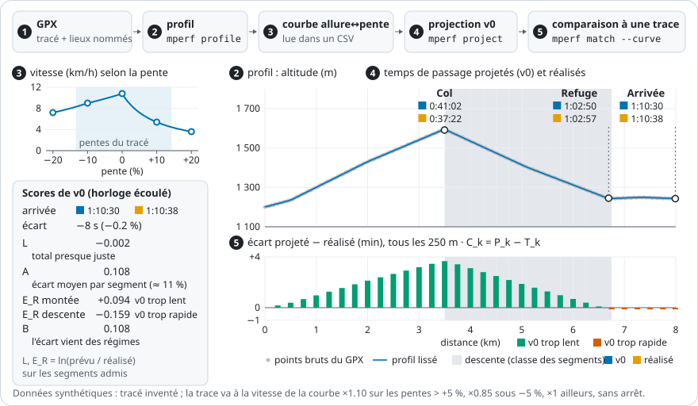

# mountain-performance-analysis

*Mountain sports data analysis and performance modelling.*

Analyse de données de sport de montagne et modélisation de la performance.

Premier outil : projeter les temps de passage sur un tracé GPX à partir de la
courbe allure↔pente de l'athlète, et valider ces projections contre des
performances réelles. Aujourd'hui, `mperf` construit le profil d'un GPX, y projette
des temps de passage avec une courbe lue dans un fichier, apparie une trace
réalisée à un tracé pour en calculer les scores, et enregistre le backtest de v0 et
de quatre autres modèles sur les performances réelles de l'athlète. En Python, pour
un usage personnel d'abord ; le dépôt ne contient aucune donnée personnelle.

Une seconde piste partage le dépôt et sa méthode : l'analyse des données
d'entraînement, de récupération et de sommeil de l'athlète, des tableaux de bord
jusqu'à l'apprentissage automatique (jalons `AN`, [`docs/analyse/`](docs/analyse/)).
Elle ingère déjà les activités et les données journalières (sommeil, HRV, FC de
repos, Body Battery, indicateurs de Garmin) des exports Garmin (`mperf ingest`), tire
des activités les tables des activités et des montées, et des jours la table `jours`,
avec les normales de six mesures (`mperf tables`), puis la figure descriptive de sa
première question, la vitesse ascensionnelle à terrain comparable (`mperf q1`).



*La chaîne de bout en bout, produite par le code de `main` (`just figure`), sur des données entièrement synthétiques. Un tracé inventé est rééchantillonné et lissé (profil) ; le moteur v0 y projette les temps de passage à partir d'une courbe allure↔pente synthétique, à effort constant, sans effet de régime ni fatigue. Une trace réalisée inventée — 10 % plus rapide que la courbe en montée, 15 % plus lente en descente, sans arrêt — est appariée au tracé. À l'arrivée, le temps total est presque juste ; pourtant le réalisé avait plusieurs minutes d'avance au col : les erreurs se compensent. Les métriques du backtest ([`0010`](docs/decisions/0010-protocole-de-backtest.md), D7.2) les font apparaître : l'écart moyen par segment `A` est grand alors que l'écart global `L` est presque nul, et il vient entièrement de la différence entre régimes (`B`, `E_R`). C'est le protocole de mesure qui voit ces erreurs, pas le modèle. Les nombres illustrent la mesure, pas une performance du modèle.*

## Pourquoi

Les règles classiques sont les mêmes pour tous les coureurs : Naismith, par
exemple, compte 5 km/h plus 1 h par 600 m de D+. Ici, la vitesse vient d'une
courbe vitesse = f(pente) propre à l'athlète, appliquée pas à pas le long du tracé.

- **Livré (moteur v0)** : `v = vitesse(pente) × effort`, avec un effort constant et
  sans dégradation : ni fatigue, ni altitude, ni chaleur. La courbe est lue dans
  un fichier, que `just curve` estime depuis les activités qu'ingère la piste
  analyse (M6b).
- **Prévu (M6a)** : la dégradation au fil de la course, dont la fatigue en
  descente selon la **profondeur** de la descente en cours, pas seulement selon
  l'avancement.

Chaque projection se mesure : le backtest compare v0 à quatre autres modèles — v0 +
effort recalé, vitesse constante, Naismith, Tobler —, et un effet n'entrera dans le
modèle que s'il fait baisser l'erreur mesurée, ou avec une justification écrite
([le backtest](docs/commandes/backtest.md), protocole
[`0010`](docs/decisions/0010-protocole-de-backtest.md)).

## L'interface

`just ui` lance une appli Streamlit locale sur le dossier des données (`MPA_DATA_DIR`), à
ouvrir sur `http://localhost:8501` : le serveur n'écoute que la machine, sans télémétrie. Elle ne calcule rien : ce qu'elle
montre vient des fonctions mêmes de `mperf` et de la bibliothèque. Cinq pages :

- **projection** : un préparé (un GPX) et une courbe (à l'origine de la course par
  défaut, sur une plage de dates, ou un fichier) donnent le profil avec les passages,
  la vitesse projetée et le tableau des passages, avec son export CSV ; les réglages
  sont générés depuis les specs des paramètres du profil et du moteur ;
- **sortie** : la trace d'une sortie face à son préparé, prévu contre réalisé, l'effort
  effectif et l'écart cumulé aux points ; c'est le contrôle d'une sortie par v0 brut,
  pas une erreur du modèle, dont le chiffre qui fait foi reste celui du backtest ;
- **La fenêtre** : pourquoi une activité qui finit tout près d'une borne de la fenêtre de
  la courbe peut ne pas être comptée ; texte seul ;
- **récupération** (piste analyse) : la table `jours`, six mesures de la nuit et du
  repos, chacune contre sa normale et sa plage, puis le journal de l'athlète et
  l'activité du jour ; exploratoire : aucune alerte, aucun verdict ;
- **Q1** : la dernière figure écrite par `just q1`, telle quelle, avec sa date.

Le détail de chaque page : [`docs/commandes/ui.md`](docs/commandes/ui.md).

## Installation

Prérequis : [`uv`](https://docs.astral.sh/uv/) et `git`. Python 3.12, la version de
la CI, que uv installe au besoin : le dépôt l'épingle dans `.python-version`
([pourquoi 3.12](CONTRIBUTING.md)).

```bash
git clone https://github.com/rdwk2/mountain-performance-analysis.git
cd mountain-performance-analysis
uv tool install rust-just       # la commande `just`
uv sync --locked --python 3.12  # .venv en Python 3.12, dépendances aux versions de uv.lock
just check                      # lint + types + tests : doit être vert
```

Les commandes sur les données réelles lisent le dossier `MPA_DATA_DIR` ; certaines
demandent un extra (`ingest`, `analyse`, `tableau`), que leur recette `just` installe
d'elle-même : [avant de commencer](docs/commandes/README.md).

## Premiers pas

Sans aucune donnée personnelle, depuis la racine du dépôt, sur les fixtures
synthétiques commitées ([`tests/fixtures/`](tests/fixtures/README.md)) : les temps de
passage sur un petit tracé inventé, avec une courbe synthétique.

```bash
uv run mperf project tests/fixtures/mini_11.gpx --curve tests/fixtures/courbe_synthetique.csv
```

```text
fichier      mini_11.gpx   sha256 7fdb9d12…
courbe       courbe_synthetique.csv   sha256 6767dd38…
             3 activités, 2026-01-01 → 2026-01-31
grille       1 000 m, 21 points, pas 50 m
lissage      150 m demandé → 150 m effectif (3 points)
support      9 tranches lues, 5 retenues (>= 10 min), plage −20 % … +20 %
             pentes rencontrées : −10 % … +10 %
             hors support : 0 % de la distance, 0 % du temps
effort       1.00
durée        0:08:30   (D+ 44 m / D− 44 m)
passages     4   (2 lieux résolus, départ et arrivée synthétisés)
      0 m   Départ                 0:00:00
      0 m   Départ                 0:00:00
    500 m   Col                    0:05:14
  1 000 m   Arrivée                0:08:30
```

Le départ et l'arrivée sont toujours synthétisés, même quand le GPX porte déjà un
lieu à ces abscisses : d'où deux lignes « Départ » à 0 m. Les autres exemples — le
profil seul, l'appariement d'une trace, le backtest sur un monde synthétique — sont
dans [les pages des commandes](docs/commandes/README.md).

## Les commandes

| Commande | Ce qu'elle fait | Lit |
|---|---|---|
| [`mperf profile`](docs/commandes/profile.md) | le profil d'un GPX : grille, lissage, lieux nommés | un GPX |
| [`mperf project`](docs/commandes/project.md) | les temps de passage, par le moteur v0 | un GPX, une courbe |
| [`mperf match`](docs/commandes/match.md) | une trace réalisée face à un tracé ; avec `--curve`, les scores de v0 brut | deux GPX ; avec `--curve`, une courbe |
| [`just backtest`](docs/commandes/backtest.md) | le backtest enregistré des cinq modèles, et sa sensibilité ; `just backtest-rolling`, le backtest glissant | `MPA_DATA_DIR` |
| [`just curve`](docs/commandes/curve.md) | la courbe allure↔pente personnelle, sur une plage ou à une origine | `MPA_DATA_DIR` |
| [`just ingest`](docs/commandes/ingest.md) | l'ingestion des exports Garmin dans `interim/` | `MPA_DATA_DIR` |
| [`just process`](docs/commandes/process.md) | l'ingestion, puis les tables des activités, des montées, des variantes et des jours | `MPA_DATA_DIR` |
| [`just project`](docs/commandes/project.md) | les temps de passage d'un préparé de `MPA_DATA_DIR/routes/` ; avec `--at`, la courbe à l'origine de la course | `MPA_DATA_DIR` |
| [`just q1`](docs/commandes/q1.md) | la figure de Q1 | `MPA_DATA_DIR` |
| [`just ui`](docs/commandes/ui.md) | l'interface | `MPA_DATA_DIR` |

## État

- **Moteur de prédiction** : M0 à M5 livrés — le profil, le moteur v0, le backtest à
  cinq modèles et sa sensibilité, l'interface ; M6b livré, la courbe personnelle
  (`just curve`) ; l'origine glissante commencée : livrés, la règle à
  l'origine (`just curve --at`), le backtest glissant (`just backtest-rolling`) et les
  pages à l'origine (`just ui`, `just project --at`).
- **Piste analyse** : AN0 à AN2 livrés — l'ingestion des activités et des données
  journalières, les tables de `processed/`, la figure de Q1, les pages
  « récupération » et « Q1 » ; AN3 commencée : la FC décalée de chaque montée
  (AN3-1a).

Le détail, jalon par jalon : [`docs/ROADMAP.md`](docs/ROADMAP.md).

## Pour aller plus loin

- [La documentation](docs/README.md) : l'index, par besoin.
- [Les commandes](docs/commandes/README.md) : chaque commande, ses options, ses sorties
  d'exemple.
- [Les décisions](docs/decisions/) : une fiche par décision structurante, dont le
  protocole de backtest ([`0010`](docs/decisions/0010-protocole-de-backtest.md)).
- [`docs/ROADMAP.md`](docs/ROADMAP.md), le plan ; [`docs/JOURNAL.md`](docs/JOURNAL.md),
  ce qui a été fait, session par session ; [`BACKLOG.md`](BACKLOG.md), les idées en
  attente.
- [Contribuer](CONTRIBUTING.md) : vérifier, la CI, les tests qui lisent la
  documentation ; les règles du dépôt sont dans [`CLAUDE.md`](CLAUDE.md).

## Comment le projet est mené

Une tâche = une branche = une pull request, relue avant fusion, avec la CI verte : la
liste des PR fusionnées est la table des matières du projet. Chaque décision
structurante a sa fiche dans [`docs/decisions/`](docs/decisions/). L'architecture, le
modèle mathématique, la métrique d'erreur et le protocole de validation sont décidés
par l'humain ; l'implémentation est assistée par Claude Code, dans les règles de
[`CLAUDE.md`](CLAUDE.md).

## Données

Ce dépôt ne contient aucune donnée personnelle (règle 1 de [`CLAUDE.md`](CLAUDE.md),
décision [`0001`](docs/decisions/0001-separation-data-code.md)). Les données
réelles vivent hors du dépôt, dans le dossier désigné par `MPA_DATA_DIR` ; les tests et
les exemples n'utilisent que les fixtures synthétiques de
[`tests/fixtures/`](tests/fixtures/README.md). Le garde-fou qui en tient Claude Code
à l'écart, et ses limites : [`CONTRIBUTING.md`](CONTRIBUTING.md).
